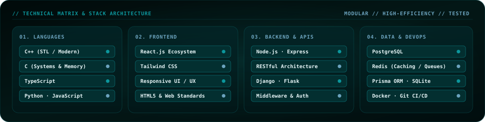

  <!-- Interactive Cosmic Space Tech Terminal Banner -->
  

    

  <!-- Quick-Link Badges in Custom Oceanic Palette -->
  
  &nbsp;
  
  &nbsp;
  
  &nbsp;
  

    

  <!-- Bento Module 1: Cute + Professional Developer Station -->
  

    

  <!-- Bento Module 2: Categorized Technical Matrix -->
  

    

  <!-- Bento Module 3: Streamlined Live Telemetry & Activity -->
  

    
    
  

  

    
    
  

   

  <!-- Interactive Cosmic Space Tech Footer Banner -->
  

